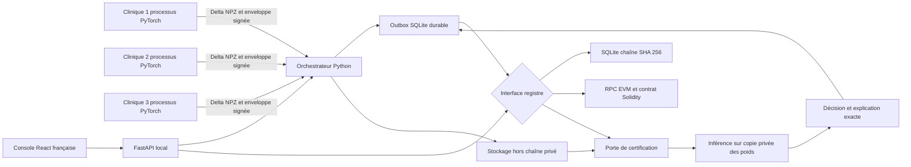

# Architecture et séquences



Frontières de confiance : les travailleurs voient leurs partitions synthétiques et leur clé ; le serveur reçoit les deltas et les volumes déclarés. Sur un seul hôte, l'administrateur peut lire les fichiers de toutes les cliniques. Les signatures attribuent les contributions aux clés locales enregistrées, sans prouver un établissement réel. Le client HTTP n'impose jamais une identité par simple nom : le jeton du dépositaire autorise les actions de la clinique 1 ; les autres contributions sont signées dans leurs propres processus. Les lectures d'audit sont locales et publiques ; le déploiement réseau requiert authentification des lecteurs et TLS.

```mermaid
sequenceDiagram
    participant C as Processus cliniques
    participant S as Serveur
    participant O as Outbox durable
    participant L as Registre
    participant U as Utilisateur synthétique
    S->>O: Enveloppe du modèle initial
    O->>L: Ancrage et confirmation
    S->>C: Poids du parent et configuration
    C->>C: Entraînement local déterministe
    C->>S: Deltas et métadonnées signées
    S->>O: Contributions et dépendance au parent
    O->>L: Soumission idempotente
    alt Registre indisponible
        O-->>S: En attente avec délai borné
        Note over S,O: Agrégation suspendue ; reprise après redémarrage
    else Toutes les contributions confirmées
        L-->>S: Reçus confirmés
        S->>S: Vérifier les deltas puis agréger
        S->>O: Modèle, métriques et exclusions
        O->>L: Ancrage du modèle
        L-->>S: Confirmation
        S->>S: Publication de la référence déployée
    end
    U->>S: Cas synthétique
    S->>S: Charger une copie et recalculer SHA 256
    S->>L: Vérifier le modèle exact
    L-->>S: Certification confirmée
    S->>S: Inférer et sérialiser l'explication exacte
    S->>O: Décision liée au modèle et à l'explication
    O->>L: Ancrage de décision
    S-->>U: Résultat et état confirmé ou en attente
    U->>L: Parcourir décision, parents et contributions
```

L'outbox conserve pending, submitted, confirmed et failed. Une erreur permanente de validation produit failed et demande une correction explicite ; une panne temporaire conserve pending. Une recherche par ID avant renvoi récupère une soumission dont la réponse s'est perdue. Les décisions générées et les enveloppes de modèle sont sauvegardées avant mise en file : la reprise conserve leurs octets, timestamps et signatures. La boucle serveur ne travaille qu'avec un verrou local ; lancer un seul worker Uvicorn par répertoire de stockage. Aucun coordinateur multi-serveur n'est implémenté.
