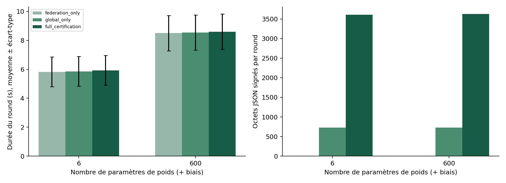

# Rapport technique FedTrace

## Objet et résultat

FedTrace réalise un parcours d'apprentissage fédéré synthétique dont chaque modèle et chaque décision peuvent être reliés à leurs preuves d'origine. Le prototype fonctionne sur un registre local persistant et sur un contrat EVM réellement déployé dans un nœud de développement. Il détecte les falsifications d'explication et refuse les modèles non certifiés. Les résultats sont pédagogiques et sans validation clinique.

Le document `Projet 5.docx` est la spécification normative ; le complément utilisateur exige aussi signatures, reprise durable, interface française, mesures répétées et tests. [La matrice](EXIGENCES.md) distingue cette portée des extensions non réalisées. Python, PyTorch, FastAPI, React TypeScript, SQLite et Solidity sont des choix justifiés dans [l'ADR](ADR-001-registre.md).

## Architecture et confiance

Les cliniques sont des processus Python séparés, lancés simultanément par le serveur sur une seule machine. Elles possèdent des clés distinctes, génèrent localement leurs partitions, entraînent puis sauvegardent un delta et signent son empreinte. Le serveur reçoit les deltas, le nombre déclaré d'échantillons d'entraînement et la configuration. Aucune ligne du jeu de données n'est renvoyée dans les messages de travailleurs. L'administrateur du poste conserve néanmoins l'accès physique à toutes les partitions et clés : cette séparation ne constitue pas une isolation hospitalière.

Le serveur orchestre les phases, valide les empreintes, attend les confirmations, agrège et évalue. Le registre n'effectue aucun apprentissage ni calcul d'agrégation. Les modèles NPZ, cas JSON et explications JSON restent dans `runtime`, exclu du contrôle de version. Le stockage emploie des chemins résolus contrôlés, des écritures temporaires puis remplacements atomiques et NPZ sans pickle. Les bases SQLite utilisent WAL et synchronous FULL. Les permissions POSIX sont restreintes lors de la création ; sous Windows, la protection dépend des ACL héritées du compte. Aucun chiffrement applicatif au repos n'est revendiqué.

Le dépositaire local détient les clés et un jeton d'administration. Les appels HTTP d'écriture sont authentifiés par ce jeton ; l'identité d'une décision HTTP est fixée à la clinique 1 autorisée par ce dépositaire. Un champ clinic fourni par le client est refusé. Les identités des contributions viennent des signatures récupérées, jamais d'un nom déclaré seul. Il n'existe pas de PKI réelle de consortium, de rotation automatique ni de séparation des administrateurs.

## Données et apprentissage

Le jeu synthétique comporte par défaut six variables standardisées, désignées inflammation, auto-anticorps, fatigue, douleur, marqueur et âge synthétiques. Ces noms sont illustratifs : les valeurs ne proviennent d'aucun protocole clinique et aucune distribution médicale n'est reproduite ou validée. Les variables suivent une loi normale avec décalage de moyenne par clinique en mode non IID. Une combinaison linéaire fixée et un bruit normal définissent l'étiquette binaire par seuil zéro ; il s'agit d'une règle mathématique artificielle.

Les trois premières cliniques génèrent 96, 128 et 160 cas ; la partition locale est 60 % entraînement, 20 % validation et le solde test, soit 57, 76 et 96 exemples d'entraînement après arrondi inférieur. Les graines sont distinctes par clinique. Le modèle est une régression logistique PyTorch, entraînée par descente de gradient SGD sur CPU, sans échange de données brutes. Les poids initiaux sont nuls et font l'objet d'un ancrage racine explicite. Les métriques globales sont calculées sur des jeux synthétiques validation/test indépendants, graines décalées de 900000 et 900001 ; leurs cas ne sont pas les cas d'entraînement des cliniques.

Le nombre de cliniques, les rounds, époques, graines, dimensions et partitions non IID sont configurables. Les tailles de cohortes suivent une règle déterministe croissante par clinique. Des graines et algorithmes déterministes rendent les exécutions reproductibles dans l'environnement verrouillé. La documentation officielle [PyTorch 2.8](https://docs.pytorch.org/docs/2.8/notes/randomness.html) ne garantit pas l'identité des résultats entre versions et plateformes ; le projet ne fait pas cette promesse. Les tests de canonicalisation concernent des valeurs identiques indépendamment de l'entraînement.

## Agrégation et attaque démontrée

FedAvg pondère chaque delta par le nombre déclaré de cas d'entraînement. Ce nombre n'est pas vérifié indépendamment. La stratégie robuste calcule la médiane coordonnée par coordonnée des vecteurs de delta puis la distance euclidienne de chaque contribution à ce centre. Elle exclut une distance supérieure à trois fois la médiane des distances, avec seuil plancher 10⁻⁶, et applique FedAvg aux autres contributions. Les raisons numériques du rejet sont ancrées.

L'attaque reproductible multiplie le delta de la dernière clinique par −30. Les contributions sont ancrées avant que leur sort soit décidé. Le scénario D utilise les **mêmes fichiers et les mêmes empreintes** pour les deux agrégateurs ; un enregistrement FedAvg supplémentaire référence les trois mêmes contributions et le même parent, tandis que le modèle robuste en rejette une. Le modèle FedAvg rejoué est conservé hors chaîne et ses métriques de test sont calculées, pas inventées.

Avec trois cliniques, le filtre suppose notamment deux contributions suffisamment proches. Les distributions honnêtes très hétérogènes peuvent provoquer de faux rejets ; une attaque discrète, des auteurs collusifs ou des déclarations de volume mensongères peuvent échapper au filtre. Il ne s'agit pas d'une preuve de résistance générale à l'empoisonnement. Les exclusions rendent la décision d'agrégation auditable, sans rendre sa qualité automatiquement correcte.

## Canonicalisation et identité

[Le format v1](CANONICALISATION.md) décrit tous les champs binaires, les longueurs, les noms triés, formes, types, ordre little endian et valeurs contiguës. Le hash distingue un modèle complet d'un delta. NaN, infinis et dtypes non numériques sont refusés. Les octets des checkpoints PyTorch ou d'une archive NPZ ne servent pas de représentation canonique.

Les métadonnées sont du JSON UTF-8 déterministe dans cet environnement Python. Les enveloppes portent une signature secp256k1 du SHA-256 des octets canoniques, avec domaine personal-sign Ethereum. Le registre récupère l'adresse et l'associe au rôle enregistré. L'attribution prouve l'usage d'une clé autorisée ; elle ne prouve pas qu'un établissement hospitalier réel a contrôlé cette clé. La compromission ou la gestion commune des clés limite toute non-répudiation organisationnelle.

## Registres et provenance

Le registre local ajoute des enregistrements SQLite, chaînés par SHA-256 du hash précédent concaténé aux octets de l'enveloppe. Chaque ID est stable et unique ; répéter la même enveloppe récupère le reçu, la modifier sous le même ID produit un conflit. Les références de contribution doivent correspondre au bon parent, à l'expérience et au round. Les parents doivent être des modèles du round précédent. La liste d'exclusions et ses raisons appartient au modèle signé. Les décisions référencent le modèle exact, son empreinte, l'explication, une clinique, un pseudonyme aléatoire et une probabilité.

Une transaction du simulateur est un reçu **local**, distinct d'une transaction blockchain. Un administrateur de la base peut reconstruire toute la chaîne : sans témoin externe, le chaînage seul ne protège pas contre une réécriture complète.

Le contrat Solidity EVM conserve les métadonnées et leurs signatures, les champs structurés, les références et un index historique. Il vérifie l'autorité de la passerelle, le rôle du signataire récupéré, les dépendances, rounds, doublons et références structurées. Le validateur Python reste responsable de la cohérence entre JSON signé et paramètres structurés soumis au contrat. Une passerelle malveillante peut donc mentir sur cette correspondance : cette confiance ne doit pas être masquée par la présence d'une blockchain.

L'adaptateur EVM signe et soumet réellement des transactions RPC, attend un reçu miné réussi puis relit l'événement. La démonstration réalisée comporte 10 preuves : racine, six contributions, deux modèles agrégés et une décision, avec trois modèles dans l'historique de clé. Les identifiants de transaction, numéros de blocs et consommations de gaz figurent dans `reports/evm-validation.json`. Le nœud Ganache persiste son état localement ; il ne constitue ni chaîne publique, ni déploiement permissionné distribué. La confirmation d'un bloc sur ce réseau de développement ne gère pas des réorganisations d'une chaîne publique. [Le guide Besu](BESU.md) délimite la migration restante.

La provenance se reconstruit récursivement depuis la décision vers son modèle, tous ses parents puis leurs contributions retenues et rejetées. Le modèle initial clôt l'arbre. Les deux adaptateurs offrent aussi l'historique de clé, la vérification de modèle et celle de décision/explication.

## Reprise et certification

L'outbox persiste les enveloppes avant soumission, avec dépendances, états pending/submitted/confirmed/failed et tentatives. Les pannes temporaires déclenchent un backoff exponentiel de 0,5 seconde à 60 secondes ; les erreurs de validation permanentes restent failed, visibles à l'opérateur. Au redémarrage, les écritures submitted sont recherchées par ID avant renvoi : une réponse perdue n'ajoute pas de doublon.

Le round conserve sa phase durable. Les résultats des travailleurs sont sauvegardés avant leur mise en file. Les enveloppes exactes des modèles et décisions sont aussi sauvegardées avant enqueue pour récupérer un arrêt à cette frontière sans changer timestamp ou signature. Le serveur sert un seul orchestrateur par répertoire, avec verrou local ; plusieurs workers serveur sur la même base ne sont pas supportés.

L'agrégation attend toutes les contributions confirmées et leur relecture en ligne. Le modèle n'est publié qu'après confirmation de son propre ancrage. Avant **chaque** inférence, le service charge une copie privée des poids, recalcule son empreinte et vérifie le modèle précis dans le registre disponible. Un défaut de certification produit `uncertified_model` ; une panne produit HTTP 503 et `ledger_unavailable` ou un motif EVM explicite. Les poids privés deviennent non modifiables pour cette inférence ; le service ne recharge pas un chemin mutable après le contrôle.

Si la décision ne peut être ancrée après calcul, son artefact et son enveloppe sont conservés et son état rendu est pending, jamais confirmed. La reprise du service la soumet ultérieurement. Les essais couvrent aussi le crash avant enqueue et la réponse perdue.

## Explications et confidentialité

Pour la régression logistique, l'explication détaille chaque produit `valeur × coefficient` dans le logit, le biais, le logit total, la version et l'empreinte du modèle. Elle est déterministe et décrit effectivement le calcul. Elle n'affirme aucune causalité médicale. Les octets UTF-8 exacts sont livrés dans `explanation_artifact` et par téléchargement HTTP, avec leur SHA-256 ; leur modification hors chaîne est détectée même si seule la mise en forme change.

Les cas reçoivent des UUID aléatoires et non des hashes de noms. Aucun poids, cas brut, explication ni secret n'est écrit dans le registre. Une probabilité et un pseudonyme constituent néanmoins des métadonnées potentiellement sensibles. La fédération seule ne garantit pas la confidentialité ; hashing ne fournit pas de confidentialité ; aucune DP ni agrégation sécurisée n'est activée. Les configurations de confidentialité consignent honnêtement ces absences.

## Expériences et résultats réellement mesurés

Le protocole complet et ses limites sont dans [BENCHMARKS](BENCHMARKS.md). Trois graines et deux tailles sont mesurées, avec trois modes appariés utilisant exactement les mêmes deltas pour chaque paire. Une seule durée d'entraînement réellement observée est partagée entre les modes ; les reprises et vérifications sont ensuite effectivement chronométrées. La configuration « modèle seul » est une ablation de checkpoint global indépendant, sans généalogie de contributions ni gate d'inférence, pas une variante certifiée du produit.

| Poids hors biais | Mode | N | Durée moyenne ± écart-type (s) | Temps moyen d'ancrage (s) | Preuves/round | Octets signés moyens/round | Croissance physique moyenne (octets) |
|---|---|---|---|---|---|---|---|
| 6 | Fédération seule | 3 | 5,820 ± 1,029 | 0 | 0 | 0 | 0 |
| 6 | Modèle seul | 3 | 5,854 ± 1,026 | 0,0433 | 1 | 725,7 | 0 |
| 6 | Contributions et certification | 3 | 5,929 ± 1,025 | 0,1193 | 4 | 3606,3 | 8192 |
| 600 | Fédération seule | 3 | 8,500 ± 1,219 | 0 | 0 | 0 | 0 |
| 600 | Modèle seul | 3 | 8,539 ± 1,219 | 0,0397 | 1 | 725,7 | 0 |
| 600 | Contributions et certification | 3 | 8,599 ± 1,223 | 0,1003 | 4 | 3627,3 | 8192 |

La différence moyenne de durée entre le mode complet et la fédération seule est d'environ 0,109 s pour six poids et 0,099 s pour 600 poids sur ce poste, soit environ 1,88 % et 1,17 %. Les observations sont affectées par les accès disque, caches et vérifications concurrentes ; elles ne justifient pas une garantie générale de coût négligeable. Le compteur d'ancrage de la baseline contient moins d'une microseconde de chronométrage, arrondie à zéro ici. Le coût de lancement des interpréteurs PyTorch domine ce petit entraînement.

L'empreinte reste de 32 octets, mais les payloads complets varient : les dimensions et résultats numériques restent dans les métadonnées. Les trois contributions et leurs schémas sont conservés entre tailles. Le zéro de croissance physique en mode modèle seul correspond à la réutilisation de pages SQLite déjà allouées ; il ne signifie pas absence d'écriture. Les tailles excluent le modèle initial et les décisions postérieures de mesure.

Les six essais de provenance en mode complet ont pris de 0,421 à 1,360 ms, pour un seul round. Les 30 falsifications d'explication testées ont toutes été détectées (30/30). Les 30 inférences avec registre sain n'ont produit aucun faux refus (0/30). Six essais de panne ont produit six refus, comptés séparément des faux refus. Ces petits échantillons ne permettent pas de conclure à un taux universel de détection ou disponibilité.

Les données brutes et écarts-types sont versionnés dans `benchmarks/`. Les valeurs de classification synthétiques servent à démontrer le flux ; elles ne sont pas une validation médicale. Les scénarios A–E, les tests backend, les tests de contrat, le build TypeScript et le test navigateur sont consignés avec leurs résultats dans [VALIDATION](../reports/VALIDATION.md).

## Interface et limites résiduelles

La console française affiche les cliniques, volumes déclarés, hashes développables et copiables, reçus, stratégies, métriques, exclusions et erreurs. L'arbre dépliable utilise les enregistrements réels de l'API. Les vues d'inférence, vérification d'explication, file de reprise et benchmark exposent les états distincts. Les contrôles de panne sont limités au mode de démonstration. Des captures et un test navigateur desktop/mobile sont fournis.

L'audit npm final de l'interface ne signale aucune vulnérabilité. La chaîne d'outils de développement Ganache/solc conserve 36 signalements transitifs (dont 5 critiques) dans l'audit enregistré ; il ne s'agit pas d'une distribution destinée à un réseau exposé. Le réseau utilisé est local, isolé et sans fonds réels ; remplacer et qualifier ces outils avant un déploiement partagé reste nécessaire. L'avertissement µWS sous Node 22 déclenche une implémentation JavaScript de repli ; les tests et transactions ont néanmoins abouti.

Les limites principales sont l'hôte et le dépositaire communs, la passerelle EVM de confiance, l'absence de déploiement distribué et de PKI hospitalière, de confidentialité différentielle, d'agrégation sécurisée et de validation indépendante des volumes. Un modèle certifié peut être mauvais : l'ancrage atteste la cohérence enregistrée d'un processus dans ses hypothèses de confiance, pas la qualité d'un diagnostic.
